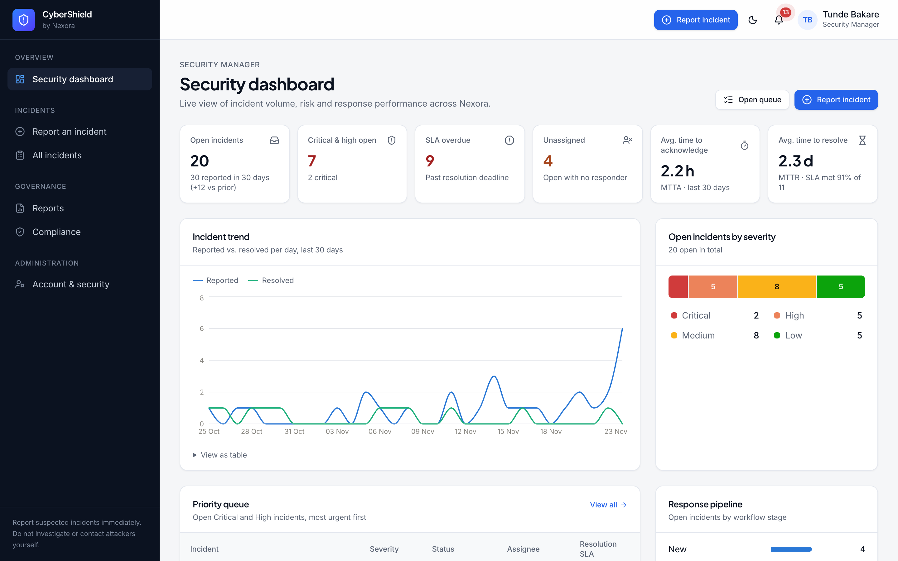

# CIRP: Cybersecurity Incident Reporting & Response Platform

A secure web platform that gives an organisation one structured place to **report, classify, respond to, monitor and audit** cybersecurity incidents. Staff report suspected incidents in plain language. The platform scores the risk automatically, routes each incident through a NIST-style response workflow with playbooks and SLAs, and keeps a tamper-evident audit trail and breach-notification records for compliance.



---

## Contents

- [Features](#features)
- [Technology stack](#technology-stack)
- [Quick start](#quick-start)
- [Demo accounts](#demo-accounts)
- [Roles and permissions](#roles-and-permissions)
- [How it works](#how-it-works)
- [Security architecture](#security-architecture)
- [Auditability](#auditability)
- [Compliance considerations](#compliance-considerations)
- [Testing](#testing)
- [Deployment](#deployment)
- [Project structure](#project-structure)
- [Limitations and future work](#limitations-and-future-work)

Further reading: [docs/ARCHITECTURE.md](docs/ARCHITECTURE.md) (diagrams, data model, risk model) and [docs/SECURITY.md](docs/SECURITY.md) (threat model, OWASP mapping).

---

## Features

| Project objective | What the platform does |
|---|---|
| **Incident reporting** | Guided report form for any member of staff: category cards with plain-language hints, CIA impact questions, data types, scope, evidence upload. A **live risk preview** shows the likely severity as the reporter answers. Reporters follow progress and message the security team on their own reports. |
| **Risk classification** | Explainable 0–100 risk score from five weighted factors (threat category, CIA impact, data sensitivity, scope, still active), mapped to Low/Medium/High/Critical and P1–P4. **Escalation rules** guarantee floors (e.g. active ransomware is always Critical). Analysts can re-assess; managers can override with a recorded justification. |
| **Response workflow** | Server-enforced state machine following NIST SP 800-61: *New → Triaged → Investigating → Contained → Eradicated → Recovered → Closed* (or *Rejected*). Category-specific **playbook checklists**, assignment, internal notes versus reporter-visible replies, closure gates (root cause, lessons learned, open tasks, regulator notification) and **four-eyes sign-off** for major incidents. |
| **Security dashboards** | KPIs (open, critical/high, SLA overdue, unassigned, MTTA, MTTR, SLA compliance), 30-day trend, severity split, response pipeline, category breakdown, team workload, priority queue and pending breach notifications. |
| **SLA management** | Acknowledge and resolve targets per priority, live SLA indicators, and **automatic escalation** of breaches to managers (background job). |
| **Reports** | Date-range management reports (category × severity matrix, departments, SLA performance), CSV export and a printable / PDF incident report. |
| **Secure architecture** | Server-side sessions, scrypt passwords, account lockout, rate limiting, TOTP MFA, RBAC with object-level checks, strict nonce-based CSP, encrypted evidence and more (see [Security architecture](#security-architecture)). |
| **Auditability** | Append-only audit log sealed with an **HMAC-SHA256 hash chain**, one-click and command-line integrity verification, per-incident audit trail, CSV export. |
| **Compliance** | Personal-data breach detection with **72-hour regulator deadline** (NDPA 2023 s.40 / GDPR Art. 33), breach register, compliance dashboard and control mapping to NIST SP 800-61, ISO/IEC 27001:2022 Annex A, NDPA/GDPR and NIST CSF 2.0. |
| **Data tables** | Sortable columns, instant filters with removable chips, debounced search, numbered pagination with page-size choice, show/hide columns and compact/comfortable density (remembered per user). Large tables (incidents, audit log) page on the server; small ones sort in the browser. Rows open on click or Enter. |
| **Look and feel** | Light, dark and system themes with a one-click toggle (no flash on load: the theme is rendered on the server), Inter / Plus Jakarta Sans / JetBrains Mono typography, staggered page and card entrances, charts and bars that draw in, animated menus and drawers, and inline loading indicators on navigation links and tables. All motion respects *reduce motion*. |
| **User administration** | Create users with one-time temporary passwords, change roles, deactivate, unlock, reset MFA, revoke sessions; every change audited and effective immediately. |

## Technology stack

| Layer | Technology |
|---|---|
| Framework | **Next.js 16** (App Router, React Server Components, Server Actions, `proxy.ts`), **React 19**, **TypeScript** |
| UI | **Tailwind CSS 4**, lucide-react icons, Recharts; Inter, Plus Jakarta Sans and JetBrains Mono (self-hosted via `next/font`); light/dark/system themes; CSS animations; responsive |
| Data | **SQLite** via **better-sqlite3** with **Drizzle ORM** (type-safe queries) |
| Validation | **Zod** on every Server Action |
| Security | Node `crypto` only (scrypt, AES-256-GCM, HMAC-SHA256, RFC 6238 TOTP); `qrcode` for MFA enrolment |
| Testing | **Vitest** (unit + integration) |
| Deployment | `next start`, Docker / Docker Compose |

## Quick start

Requirements: **Node.js 20.12+** (22 LTS recommended) and npm.

```bash
npm install
npm run setup      # creates .env.local with strong random secrets
npm run db:seed    # optional: demo users + ~45 realistic incidents
npm run dev        # http://localhost:3000
```

`npm run db:reset` deletes the database and evidence store and seeds again. The demo data is fictitious and generated deterministically.

## Demo accounts

All demo accounts use the password **`Demo@Passw0rd!`** (they are listed on the sign-in page while `SHOW_DEMO_ACCOUNTS=true`).

| Email | Role | Try this |
|---|---|---|
| `staff@cirp.local` | Reporter | Report an incident, watch the live risk preview, follow your reports |
| `analyst@cirp.local` | Security Analyst | Triage, assign to yourself, work the playbook, move through the workflow |
| `manager@cirp.local` | Security Manager | Assign, override severity, close Critical incidents, reports |
| `auditor@cirp.local` | Compliance Auditor | Read-only: incidents, compliance, audit log, exports |
| `admin@cirp.local` | System Administrator | Users and roles, unlock `ngozi.uche@cirp.local` (locked by a simulated brute-force attack) |

## Roles and permissions

Least privilege: permissions belong to roles ([src/lib/rbac.ts](src/lib/rbac.ts)), and object-level checks stop a reporter from seeing anyone else's report even by guessing URLs.

| Capability | Reporter | Analyst | Manager | Admin | Auditor |
|---|:-:|:-:|:-:|:-:|:-:|
| Report incidents, follow own reports | ✔ | ✔ | ✔ | ✔ | |
| View all incidents and dashboard | | ✔ | ✔ | ✔ | ✔ (read-only) |
| Triage, workflow, tasks, internal notes | | ✔ | ✔ | ✔ | |
| Assign others, override severity, close High/Critical, reopen | | | ✔ | ✔ | |
| Reports and CSV export, compliance overview | | | ✔ | ✔ | ✔ |
| Audit log | | | | ✔ | ✔ |
| User and role administration | | | | ✔ | |

## How it works

1. **Report.** A reporter submits the form. The server validates it, classifies the risk, sets SLA deadlines, generates the playbook, encrypts the evidence, records an audit entry and notifies responders. Reports involving personal data get a 72-hour regulator deadline.
2. **Triage.** An analyst acknowledges the incident (acknowledge SLA), confirms or re-assesses the risk, and assigns it.
3. **Respond.** The incident moves through containment, eradication and recovery while the playbook tasks are ticked off. Internal notes stay with the team; replies go to the reporter.
4. **Close.** Closure requires a resolution summary and root cause, no open tasks, and the regulator notification (if notifiable). High and Critical incidents also need lessons learned and **manager** sign-off.
5. **Oversee.** Dashboards, reports and the compliance overview update live. Overdue SLAs are escalated automatically, and the audit trail can be verified at any time.

Risk model, SLA table and diagrams: [docs/ARCHITECTURE.md](docs/ARCHITECTURE.md).

## Security architecture

| Control | Implementation |
|---|---|
| **Authentication** | scrypt (N=2¹⁵, r=8) with per-user salt; NIST SP 800-63B password policy (length, block-list, no personal info); constant-time responses for unknown emails (no user enumeration) |
| **Brute-force protection** | Account lockout after 5 failures (15 min) plus per-IP rate limiting; admins notified of lockouts |
| **Multi-factor authentication** | TOTP (RFC 6238) with QR enrolment, replay protection, encrypted secrets; can be **enforced** for privileged roles (`REQUIRE_MFA_FOR_PRIVILEGED`) |
| **Sessions** | Opaque 256-bit token in an `HttpOnly`, `SameSite=Strict`, `Secure` cookie; only an HMAC of the token is stored; 30-minute idle and 8-hour absolute timeouts; new token on login and after MFA (no fixation); revoked on password change, role change and deactivation |
| **Authorization** | RBAC plus object-level checks in the data access layer ([src/server/auth/dal.ts](src/server/auth/dal.ts)); every Server Action and API route re-authenticates; denied attempts are audited; unknown or forbidden incidents both return 404 |
| **CSRF** | Server Actions are POST-only with Origin/Host verification; SameSite=Strict cookies |
| **XSS / injection** | React output escaping; strict **nonce-based CSP** (`script-src 'nonce-…' 'strict-dynamic'`); Zod validation; parameterised SQL only; CSV formula-injection neutralised |
| **Security headers** | CSP, HSTS, X-Frame-Options DENY, frame-ancestors 'none', nosniff, Referrer-Policy, COOP/CORP, Permissions-Policy |
| **Evidence handling** | Extension and magic-byte allow-list; **AES-256-GCM encryption at rest**; random file names outside the web root; SHA-256 chain-of-custody re-verified on every download; always served as an attachment with a sandbox CSP |
| **Secrets** | Only in environment variables; generated by `npm run setup`; the app refuses to start without them |
| **Errors** | Generic error pages with a reference ID; no stack traces shown to users |

Threat model and OWASP Top 10 mapping: [docs/SECURITY.md](docs/SECURITY.md).

## Auditability

- **What is logged:** sign-ins (success, failure, lockout, MFA), sign-outs, access denials, every incident change (creation, views, status, assignment, classification, override, tasks, comments, evidence upload and download, breach decisions), user administration, exports and integrity checks. Each entry records actor, role, IP, user agent, request ID and outcome. Message bodies are not copied into the log (data minimisation).
- **Tamper evidence:** `hash = HMAC-SHA256(key, prev_hash ‖ entry)`. Database triggers reject `UPDATE`/`DELETE`. Editing, deleting or re-ordering any row breaks the chain, and the HMAC key means a database-only attacker cannot rebuild it.
- **Verification:** *Audit log → Verify integrity now*, the compliance page, or `npm run audit:verify` (exits non-zero on tampering, so it can run in CI or cron). Record the displayed *head hash* externally (e.g. in a monthly report) to also detect truncation of the newest entries.

## Compliance considerations

- **Nigeria Data Protection Act 2023, s.40 / GDPR Art. 33:** incidents involving personal data with confirmed exposure are flagged as notifiable, with a deadline 72 hours after the report. The breach register tracks the regulator, time and reference; overdue notifications are highlighted, and closure is blocked until notification is recorded.
- **ISO/IEC 27001:2022 Annex A:** A.5.24–A.5.28 (incident management, assessment, response, learning, evidence), A.6.8 (event reporting), A.8.5 (secure authentication) and A.8.15 (logging) are mapped on the *Compliance* page with live evidence.
- **NIST SP 800-61 / CSF 2.0:** workflow stages and the RS.MA, RS.AN, RS.CO and RC.RP functions.
- **Accountability:** four-eyes closure for major incidents, mandatory lessons learned, justification required for overrides, rejections and reopenings.

> The platform supports compliance; it does not by itself make an organisation compliant. Policies, training and legal review are still required.

## Testing

```bash
npm test           # 50 unit + integration tests (Vitest)
npm run typecheck  # TypeScript, including tests and scripts
npm run lint
```

The tests cover the risk engine and escalation rules, every workflow rule (including four-eyes and the breach gate), the RBAC matrix, scrypt/AES-GCM/TOTP (RFC 6238 test vector), rate limiting, the password policy, CSV injection, audit-chain tamper and deletion detection, IDOR protection, internal-note confidentiality, and evidence encryption and integrity failure.

## Deployment

**Node:**
```bash
npm ci && npm run setup && npm run build && npm start
```

**Docker Compose:**
```bash
npm run setup                 # creates .env.local with the secrets
docker compose up -d --build  # http://localhost:3000
docker compose exec cirp npm run db:seed -- --force   # optional demo data (overrides the production guard)
```

Production checklist:
- Serve over **HTTPS** behind a reverse proxy and keep `SECURE_COOKIES` at its default (`true`). Set it to `false` only for plain-HTTP demos.
- Configure the proxy to *overwrite* `X-Forwarded-For`, so audit IPs and rate limits use the real client address.
- Set `SHOW_DEMO_ACCOUNTS=false`, `REQUIRE_MFA_FOR_PRIVILEGED=true` and, if needed, `ALLOWED_EMAIL_DOMAINS`.
- **Back up `DATA_ENCRYPTION_KEY`** separately from the database. Without it, encrypted evidence cannot be recovered.
- Back up `data/` (SQLite database) and `storage/` (encrypted evidence) regularly.

All settings are documented in [.env.example](.env.example).

## Project structure

```
src/
├── app/                      Next.js routes
│   ├── (auth)/               sign-in, MFA challenge, registration
│   ├── (app)/                authenticated app: dashboard, incidents, reports,
│   │                         compliance, audit, admin/users, account, notifications
│   ├── print/incidents/[id]  printable incident report
│   └── api/                  evidence download, CSV exports, notifications, health
├── components/               UI kit, app shell, charts, incident components
├── lib/                      pure domain logic: risk engine, workflow, RBAC, playbooks
├── server/
│   ├── actions/              Server Actions (Zod-validated mutations)
│   ├── auth/                 sessions + data access layer (authn/authz)
│   ├── db/                   Drizzle schema + SQL bootstrap (incl. audit triggers)
│   ├── security/             crypto, TOTP, rate limiting
│   ├── services/             incidents, users, auth, evidence, analytics, notifications
│   └── audit.ts              hash-chained audit trail
├── proxy.ts                  CSP nonce, request IDs, optimistic auth redirect
└── instrumentation.ts        SLA escalation scheduler
scripts/                      setup, seed, audit verification
test/                         Vitest suites
docs/                         architecture, security, screenshots
```

## Limitations and future work

- Notifications are in-app only; e-mail/SMS/Slack alerts would be a natural extension.
- SQLite suits a single server. Drizzle makes a move to PostgreSQL straightforward for multi-instance deployments; the in-memory rate limiter would then move to Redis.
- No direct SIEM/EDR ingestion: incidents are reported by people, not raised automatically from security tooling.
- No automated prevention or detection of attacks; the platform supports their reporting and management (in line with the project scope).
- SSO (SAML/OIDC) and recovery codes for MFA are not included.
# CyberShield
