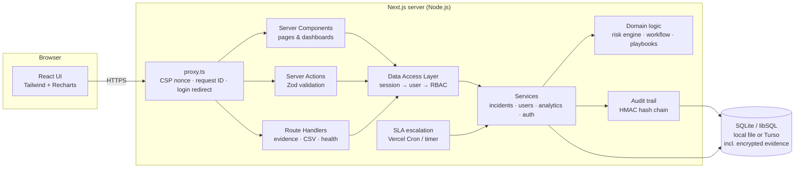
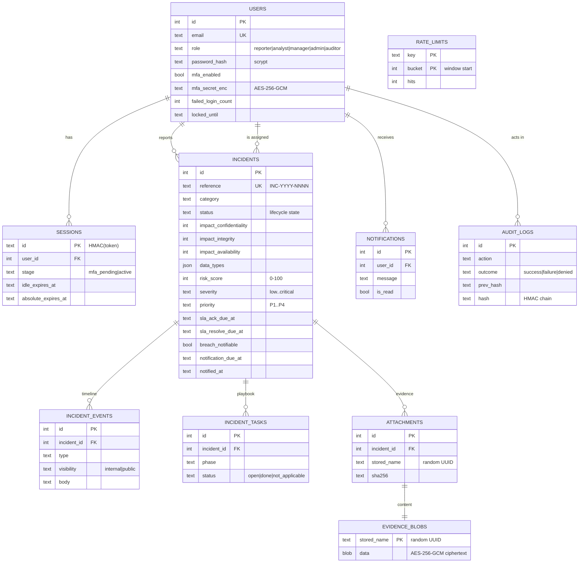
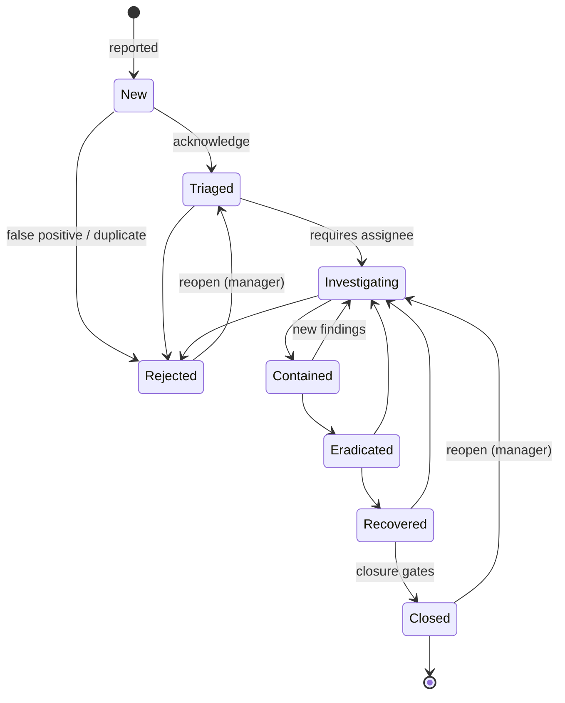

# System architecture

## 1. Overview

CIRP is a single Next.js application. Every page is rendered on the server for the current request, mutations go through Server Actions, and all data access passes through one server-side layer that enforces authentication and authorization.



**Layers**

| Layer | Location | Responsibility |
|---|---|---|
| Presentation | `src/app`, `src/components` | Pages, forms, charts. Server Components by default; Client Components only for interactivity. |
| Edge of the request | `src/proxy.ts` | Per-request CSP nonce, request ID, redirect of visitors without a session. |
| Application | `src/server/actions`, `src/app/api` | Input validation (Zod), calls into services, cache revalidation. |
| Access control | `src/server/auth` | Session validation, user resolution, `requireUser`, `requirePermission`. |
| Domain | `src/server/services`, `src/lib` | Business rules: classification, workflow, SLAs, compliance gates. |
| Persistence | `src/server/db`, `src/server/services/evidence.ts` | SQLite/libSQL via Drizzle (a local file, or Turso when hosted on Vercel); evidence stored encrypted in the database. |
| Cross-cutting | `src/server/audit.ts`, `src/instrumentation.ts`, `src/app/api/cron/sla` | Tamper-evident audit log; SLA escalation (timer on long-running servers, Vercel Cron on serverless). |

## 2. Reporting an incident (sequence)

```mermaid
sequenceDiagram
  actor R as Reporter
  participant UI as Report form
  participant SA as createIncidentAction
  participant DAL as Data access layer
  participant S as Incident service
  participant DB as Database (SQLite / Turso)

  R->>UI: fill in form (live risk preview runs classify() in the browser)
  UI->>SA: POST (Server Action, same-origin only)
  SA->>DAL: resolve session → user, check incident.create
  SA->>SA: Zod validation, evidence type/magic-byte checks
  SA->>S: createIncident(user, input, files)
  S->>S: classify() → score, severity, priority, rules; SLA due dates; playbook
  S->>S: encrypt evidence (AES-256-GCM), record SHA-256
  S->>DB: transaction: incident + reference + tasks + encrypted evidence + attachments + timeline event
  S->>DB: audit entry (hash-chained)
  S->>DB: notifications to responders
  SA-->>UI: redirect to /incidents/{id}
```

## 3. Data model



The physical schema, including CHECK constraints and the append-only triggers, is in [src/server/db/bootstrap.ts](../src/server/db/bootstrap.ts); the Drizzle definitions are in [src/server/db/schema.ts](../src/server/db/schema.ts).

## 4. Response workflow



**Closure gates** (all enforced on the server, [src/lib/workflow.ts](../src/lib/workflow.ts)):
- resolution summary (≥ 20 chars) and root cause (≥ 10 chars);
- no open playbook tasks;
- regulator notification recorded if the incident is a notifiable breach;
- High/Critical: lessons learned and sign-off by a manager or administrator (four-eyes).

Rejections and reopenings require a written justification.

## 5. Risk classification model

Score = sum of five factors (max 100), from [src/lib/risk.ts](../src/lib/risk.ts):

| Factor | Max | How it is scored |
|---|---:|---|
| Threat category | 30 | Ransomware 30, Data breach 28, Unauthorized access 24, Insider 22, Malware/Account compromise 20, DoS 18, Phishing/Lost device 14, Social engineering 12, Vulnerability 10, Other 8, Policy violation 6 |
| CIA impact | 30 | (C + I + A) / 9 × 30, each rated 0–3 from plain-language questions |
| Data sensitivity | 15 | Highest data type (Health 15, Financial 13, Credentials 12, Personal 10, IP 10, Business 8) + 2 per extra type |
| Scope | 15 | 1 person 3 · 2–10: 6 · 11–100: 9 · 101–1,000: 12 · 1,000+: 15 · unknown 5 |
| Still active | 10 | Yes 10 · Not sure 5 · No 0 |

| Score | Severity | Priority | Acknowledge within | Resolve within |
|---|---|---|---|---|
| ≥ 70 | Critical | P1 | 15 minutes | 24 hours |
| 45–69 | High | P2 | 1 hour | 3 days |
| 25–44 | Medium | P3 | 8 hours | 7 days |
| < 25 | Low | P4 | 24 hours | 14 days |

**Escalation rules (severity floors):**
- R1: active ransomware → Critical
- R2: personal data exposed (C ≥ 2) affecting > 100 people → Critical
- R3: confirmed exposure of health or financial data → at least High
- R4: ongoing outage of critical services → at least High

A **personal-data breach** (personal data involved, plus confidentiality or integrity ≥ 2, or category *Data breach*) is flagged as notifiable with a deadline 72 hours after the report.

## 6. Key design decisions

| Decision | Rationale |
|---|---|
| Server-rendered pages, no server-side caching (`cacheComponents: false`) | Every page shows confidential, permission-filtered data; rendering per request guarantees revocations and role changes apply immediately and allows a per-request CSP nonce. |
| Server Actions instead of a separate REST API | Mutations stay on the server, get built-in Origin checks (CSRF) and are re-authorised on every call. |
| Server-side sessions instead of JWTs | Instant revocation (logout everywhere, deactivation) and no sensitive claims in the browser. |
| Pure domain modules (`src/lib`) | The same risk engine powers the live preview in the browser and the authoritative classification on the server, and is unit-testable. |
| SQLite / libSQL + Drizzle | Zero setup locally (a single file) and the same SQL dialect, triggers and code on Turso for serverless hosting. |
| Evidence and rate limits in the database | Serverless functions have no persistent disk and no shared memory; keeping both in the database makes every instance consistent. |
| Serialised access to local SQLite | The local driver is synchronous, so an in-process lock queues queries behind open transactions instead of letting them block each other (Turso queues writes server-side). |
| Hash-chained audit log with DB triggers | Defence in depth: the database blocks edits, and the HMAC chain detects any that get through. |
